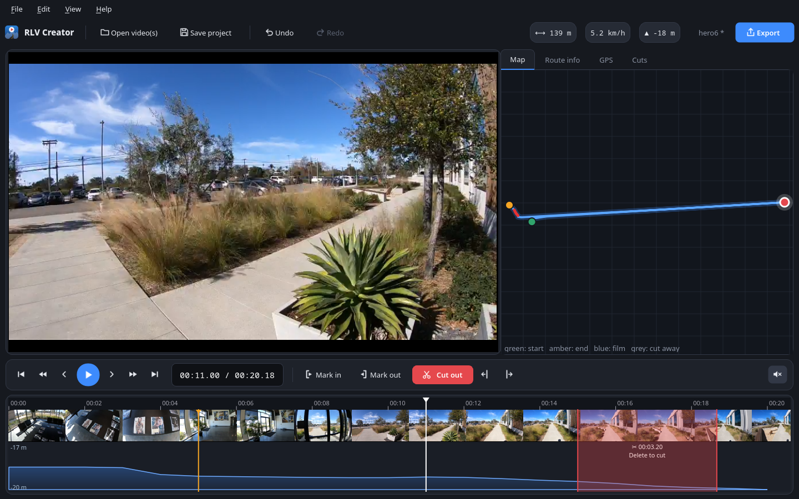

# Artilody RLV Creator

**Make Real Life Videos (RLV) from GoPro recordings.** Open a GoPro video, cut away the parts you
don't want, and export the finished RLV. The video and the GPS track always stay in sync.



An RLV is made of three files:

| File | Contents |
|------|----------|
| `Name.mp4` | Video in **H.265 / HEVC**, **1920×1080 (16:9)**, **30 fps** |
| `Name.gpx` | GPS track with one point per second of the film: position, elevation, speed (plus heart rate and cadence if you have them) |
| `Name.xml` | Route description: name, ID, country, title, frame range and information texts |

The GPX and XML files use the same layout as standard RLV files (`gpx-import` XML with German/English
information texts, and GPX with `gte:gps speed` and Garmin `TrackPointExtension`).

## Features

- **Reads GPS from GoPro videos.** It reads the GPMF telemetry stream (`GPS5` on HERO5 to HERO10 and MAX, `GPS9` on HERO11 and later).
  You don't need any other tools.
- **Joins chapters automatically.** A long ride that the camera split into `GH010123.MP4`, `GH020123.MP4`, … is loaded as one film.
- **Cuts video and GPS together.** Mark a part and press *Delete*. The same seconds are removed from the
  video and from the GPS data, and the film closes the gap at once.
- **Undo / redo** for every cut, without limit. Removed parts are also listed under the *Cuts* tab, where you can restore them one by one.
- **Frame-accurate.** Cuts are placed on single frames at 30 fps. The exported video has exactly the
  number of frames written to the XML (`end-frame`), and the GPX has one point per second of film.
- **Plays the edited film.** Playback skips the parts you removed, so you see the finished film.
- **Map and elevation profile.** The map shows the route and your position. Click the map to jump
  there. The elevation profile is drawn in the timeline.
- **Information texts.** Add a text at the current position with one click. A *Route summary* text with
  length, ascent and difficulty in German and English can be generated for you.
- **GPS clean-up.** Points without a fix or with poor precision (DOP) are dropped, and elevation is
  smoothed so gradients are even.
- **Optional heart rate and cadence.** GoPro cameras don't record these. You can import a GPX/TCX file
  from a bike computer or watch, and it is matched to the video by GPS time.
- **Hardware encoding** with NVIDIA NVENC, Intel Quick Sync, AMD AMF or Apple VideoToolbox when your
  computer supports it. Otherwise x265 is used.
- **Projects** (`.rlvproj`) save your work so you can continue later.
- FFmpeg is included, so you don't need to install anything else.

## Download

Get the latest version from the [**Releases page**](https://github.com/shenphenchoedron-hue/Artilody-RLV-Creator/releases/latest).

| System | File |
|--------|------|
| Windows 10/11 (64-bit) | `Artilody-RLV-Creator-x.y.z-Windows-Setup.exe` (installer) or `…-Windows-Portable.zip` |
| macOS 11+ Apple Silicon (M1/M2/M3/M4) | `Artilody-RLV-Creator-x.y.z-macOS-AppleSilicon.dmg` |
| macOS 11+ Intel | `Artilody-RLV-Creator-x.y.z-macOS-Intel.dmg` |
| Debian 12/13 and Ubuntu 22.04/24.04 or newer (64-bit) | `artilody-rlv-creator_x.y.z_amd64.deb` |
| Other Linux distributions (64-bit) | `Artilody-RLV-Creator-x.y.z-Linux-x86_64.tar.gz` |

### Installation

**Windows:** Run the installer. Windows SmartScreen may warn about an unknown publisher because the
app isn't code-signed. Click *More info* and then *Run anyway*.

**macOS:** Open the `.dmg` and drag the app into *Applications*. The app isn't notarised by Apple, so
the first time you start it, right-click the app and choose *Open*, then *Open* again. If macOS says
the app is "damaged", run this in Terminal:

```bash
xattr -dr com.apple.quarantine "/Applications/Artilody RLV Creator.app"
```

**Debian / Ubuntu:**

```bash
sudo apt install ./artilody-rlv-creator_*_amd64.deb
```

Then start *Artilody RLV Creator* from the application menu, or run `artilody-rlv-creator` in a terminal.

**Other Linux:** Unpack the `.tar.gz` and run `artilody-rlv-creator/artilody-rlv-creator`.

## How to use it

1. **Open the video:** Click *Open GoPro video(s)…* on the start screen or drop the files onto the window. If the ride was
   split into several files, select all of them; they are put in order automatically.
2. **Find the parts to remove:** Play the film (*Space*), drag in the timeline, or click on the map.
3. **Mark a part:** Drag across the timeline with the mouse, or press **I** at the start and **O** at
   the end. You can drag the red edges to adjust the marking.
4. **Cut it out:** Press **Delete** or click the red **✂ Cut out** button. The part is removed from the video
   and the GPS track, and the film closes the gap. The two buttons next to it (*Cut start → here* and
   *Cut here → end*) trim the start and end.
5. **Made a mistake?** Press **Ctrl+Z** to undo and **Ctrl+Y** to redo.
6. **Route info:** On the *Route info* tab, enter the title and country and add information texts
   (*+ Here* adds a text at the current position, *+ Summary* adds a route summary). Write `\n` for a line break.
   Distance, speed and elevation at the current position are shown at the top right.
7. **Export:** Click the blue **Export** button (or press **Ctrl+E**) and choose a folder and name. You get `Name.mp4`, `Name.gpx` and `Name.xml`.

### Keyboard shortcuts

| Key | Action |
|-----|--------|
| Space | Play / pause |
| ← / → | One frame back / forward |
| Shift + ← / → | One second back / forward |
| Ctrl + ← / → | Ten seconds back / forward |
| ↑ / ↓ | Previous / next cut point |
| Home / End | Start / end of the film |
| I / O | Mark the start / end of the part to remove |
| Delete, Backspace or X | Cut the marked part out |
| Esc | Clear the marking |
| Ctrl + Z / Ctrl + Y | Undo / redo |
| Ctrl + S | Save project |
| Ctrl + E | Export |
| Drag across timeline | Mark a part (click = move playhead, drag in time ruler = scrub) |
| Mouse wheel on timeline | Zoom (Shift + wheel or middle-drag scrolls) |

## Technical details

- **Timeline:** All chapter files are joined into one source timeline at 30 fps. An edit is a list of
  kept frame ranges. The video and the GPS track are both built from this same list, so they can't get out of sync.
- **GPS:** Raw samples (about 18 Hz for `GPS5`, 10 Hz for `GPS9`) are filtered by fix and DOP, averaged
  onto a 10 Hz grid, and then sampled at every whole second of the edited film. GPX time stamps start at
  `1999-12-31T23:00:00Z` like the reference files. On the *GPS* tab you can choose the real UTC recording time instead.
- **Video:** FFmpeg decodes each chapter, converts it to 30 fps, keeps exactly the selected frames,
  scales to 1920×1080 (crop to fill, or letterbox) and encodes HEVC with the `hvc1` tag, 2-second GOPs
  and `+faststart`.
- **XML:** Non-ASCII characters are written as HTML named entities (`&auml;`, `&szlig;`, …), and line
  breaks as `\n`, the same way as in the reference RLV files.

## Running from source

Requires Python 3.10 or newer.

```bash
git clone https://github.com/shenphenchoedron-hue/Artilody-RLV-Creator.git
cd Artilody-RLV-Creator
python -m venv .venv
source .venv/bin/activate          # Windows: .venv\Scripts\activate
pip install -r requirements-dev.txt
python -m rlvcreator               # start the app
python -m pytest tests             # run the tests
pyinstaller packaging/rlvcreator.spec   # build a standalone app in dist/
```

Releases are built by GitHub Actions (`.github/workflows/release.yml`) for Windows, macOS (Apple Silicon
and Intel) and Linux whenever a tag `v*` is pushed. The Linux `.deb` is test-installed on Debian 12,
Debian 13, Ubuntu 22.04 and Ubuntu 24.04.

### Project layout

```
rlvcreator/
  mp4.py        MP4/ISO-BMFF parser (sample tables, edit lists, chapters)
  gpmf.py       GoPro GPMF telemetry parser (GPS5 / GPS9)
  track.py      GPS cleaning, smoothing, resampling, distance and ascent
  edit.py       Frame-accurate edit model with undo/redo
  project.py    Project: chapters, GPS, edit, metadata, save/load
  exporters.py  GPX and XML writers (reference format)
  ffmpeg.py     FFmpeg discovery, HEVC encoder detection, rendering
  sensors.py    Optional heart rate / cadence import (GPX/TCX)
  ui/           PySide6 user interface
tests/          pytest suite (GPMF parsing, editing, exporters, frame-accurate rendering)
packaging/      PyInstaller spec, .deb builder, Inno Setup script, icons
```

## Kort på dansk

Artilody RLV Creator laver Real Life Videos ud fra GoPro-optagelser:

- GPS-data hentes direkte fra GoPro-filmen.
- Du klipper uønskede stykker ud: træk hen over tidslinjen (eller brug **I** og **O**), og tryk på **Delete**. Det samme stykke
  fjernes automatisk fra GPS-dataene, og filmen samles igen af sig selv.
- Du kan fortryde med **Ctrl+Z** og gentage med **Ctrl+Y**.
- Eksporten giver en MP4 (H.265/HEVC, 1080p, 16:9, 30 fps), en GPX-fil og en XML-fil i samme format
  som standard RLV-filer.

Hent programmet til Windows, Mac, Debian eller Ubuntu under
[Releases](https://github.com/shenphenchoedron-hue/Artilody-RLV-Creator/releases/latest).

## License

GNU General Public License v3.0. See [LICENSE](LICENSE).
The release builds include [FFmpeg](https://ffmpeg.org) (GPL, via `imageio-ffmpeg`) and
[Qt for Python / PySide6](https://www.qt.io/qt-for-python) (LGPL v3).
The test data excerpt in `tests/data` comes from an RLV by cycling.vangestel.online (CC BY-NC-SA 4.0).
GoPro sample videos used in the tests are downloaded from [gopro/gpmf-parser](https://github.com/gopro/gpmf-parser).
